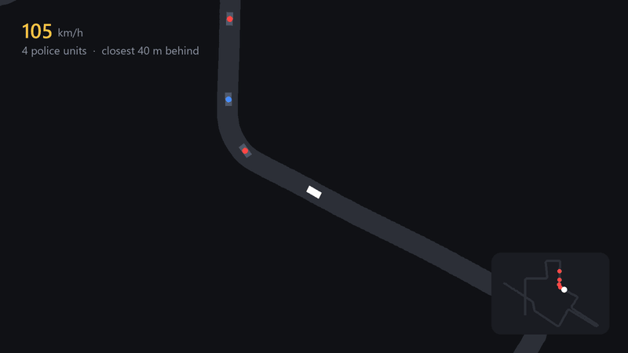

# Police Chase AI

**Autonomous police bots for an online Assetto Corsa server.** They chase players the way Need for Speed cops
do: tail, flank, box in, ram, set roadblocks. And like human drivers, they make mistakes.



<sub>A chase from the simulator, which runs the plugin's real driving code on the server's road data. Played at 1.5× speed.</sub>

## What the cops do

| Wanted level | Units | Tactics |
|---|---|---|
| ★ | 2 | **Tail** you and **flank** on the neighbour lane |
| ★★ | 3 | Pull **alongside** and swipe, **block** the lane ahead |
| ★★★ | 4 | **PIT ram** from behind, **roadblocks** ahead |
| ★★★★ | 5 | **Head-on** cops coming down your lane |
| ★★★★★ | 6 | Two rammers at once, faster backup |

- **Busted** when you stay under 30 km/h within 25 m of a cop. **Escape** when no cop has seen you for 10 seconds.
- **Not scripted.** Each driver gets a random nerve and aggression. Hits, sudden moves and tyre load raise stress,
  and stressed drivers wobble, lose track or spin out.
- **Radio and voice lines** ("Pull over now!") and a pursuit meter in the player's HUD.

## How it drives

```
Player's line on the road ──► predicted route ahead ──► tactic picks a target point
                                                          │
          pure-pursuit steering  ◄─── kinematic bicycle model ───►  IDM + Gipps pedals
                                                          │
                     smooth, continuous motion sent to every player at 30 Hz
```

- **Physics-like motion on a server that has no physics:** a bicycle model with jerk limits, so cops never stutter or teleport.
- **Rubber band:** cops stay faster than the player's car (a 531 bhp Caprice) and gain a bonus the further back they fall.
- **Tuned in a simulator, not in-game.** `CopBotPlugin/sim` compiles the same driving files and replays 17 scenarios on the
  real road (191,000 lane points), writing CSV logs and charts. Changes ship only after the simulator says they work.

## Code

```
CopBotPlugin/         AssettoServer plugin (C#, .NET 8)
  CopBot.cs           watches players, starts a pursuit for each
  Pursuit.cs          wanted level, units, busted / escape meters
  CopUnit.cs          tactics: tail, flank, alongside, block, ram, roadblock, head-on
  CopDriver.cs        steering and pedals (bicycle model, IDM, Gipps)
  PlayerRoute.cs      the player's smoothed line and predicted road
  DriverNerve.cs      composure, stress and random mistakes
  CarContact.cs       collisions: box overlap, momentum, spin
  lua/copbot_hud.lua  in-game HUD and voice playback
  audio/              17 CC0 voice clips (CREDITS.txt)
  sim/                the simulator and its charts
single-player/        a first, offline version as a CSP Lua game mode
```

About 4,800 lines. Built on [AssettoServer](https://github.com/compujuckel/AssettoServer): put `CopBotPlugin` in its
source tree, `dotnet publish CopBotPlugin -c Release -r linux-x64`, and enable the plugin in `extra_cfg.yml`.
